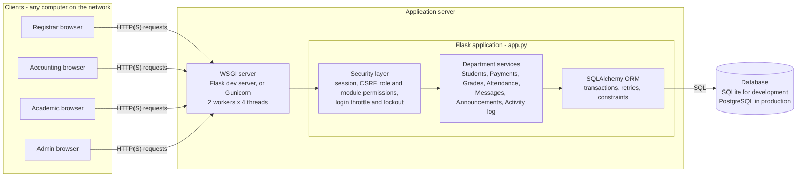
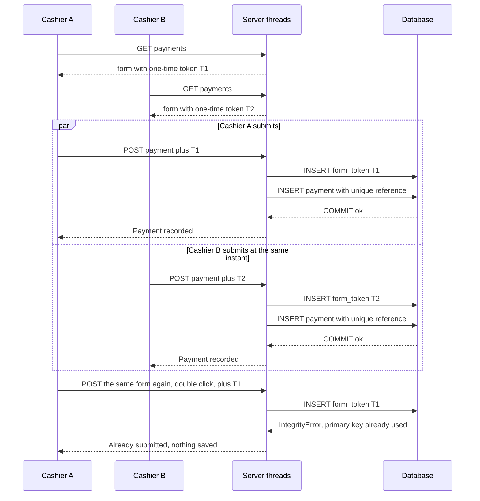
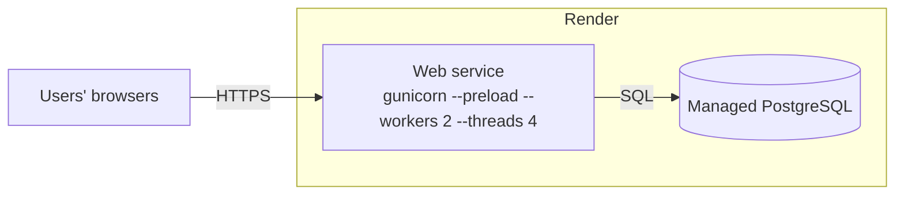

# System architecture

## 1. Components

| Layer | What it does | Technology |
|---|---|---|
| Client | Renders pages, sends form submissions | Any browser (HTML, CSS, small JavaScript file) |
| Network | Carries requests between machines | HTTP, HTTPS on the hosted deployment |
| Application server | Accepts many requests at once | Flask development server (threaded) locally; Gunicorn with 2 worker processes x 4 threads on Render |
| Services | Role-based features for each department | Flask routes and Jinja templates |
| Data access | Transactions, unique-constraint handling, retries | Flask-SQLAlchemy / SQLAlchemy 2 |
| Database | Single source of truth and the final arbiter of conflicts | SQLite (WAL mode) locally, PostgreSQL on Render |

## 2. Roles

| Role | Responsibilities |
|---|---|
| Registrar | Add, edit and delete students (photos, sections); manage sections; can open the grades page; receives department messages |
| Accounting | Record payments (unique references, history, date filters); prepare, save and print the financial reports (balance sheet, income statement, cash flow, changes in equity, budgets, projection, billing statements); receives department messages |
| Academic | Courses, grades, weighted assessments and attendance; can view students. Teachers and the weekly timetable are managed by Admin or by an Academic account the Admin has granted that permission |
| Admin | Everything above, plus staff accounts, per-account module permissions (view, create, edit or delete for each module), announcements, audit-report access, unlocking locked accounts (login security) and deleting courses |

## 3. Transaction flow: two cashiers at the same time

## 4. Parallel and distributed design

The system does not use hand-written locks around database work. Instead it lets many requests run in parallel and makes the **database** the arbiter: transactions, unique constraints and compare-and-set updates guarantee that conflicting writes cannot both succeed.

**Where work is distributed**

- Clients: each browser is an independent session; many computers can use the system at once over the network.
- Server: the WSGI server runs several request threads (and, with Gunicorn, several processes), so requests from different users are handled in parallel.
- Database: runs separately from the web server on the hosted deployment (managed PostgreSQL).

**What can run concurrently:** all reads; writes to different rows (for example, payments for different students); and registrations, payments and grades from different users. **What is serialized:** conflicting writes to the same row or unique value (the database lets one win), and, on SQLite only, the write step itself (one writer at a time; WAL mode and a 30 second busy timeout make waiting writers queue instead of fail).

**How each risky operation is protected**

| Situation | Protection | Result |
|---|---|---|
| Several registrars add students at once | Next student number is computed, `student_number` is unique, a collision rolls back and retries (up to 8 times with random back-off) | Unique numbers, none lost |
| Same grade submitted twice at once | Unique (student, course, semester) plus `IntegrityError` handling | One row stored, the rest get a "duplicate" message |
| Two users edit the same grade | Compare-and-set: the edit form carries the grade the user saw; the `UPDATE` applies only if it is still that value | One edit wins, the other sees an "Edit conflict" message (no silent lost update) |
| Same attendance entry at once | Unique (student, course, date); the losing request is turned into an update | One row, no server error |
| Payment form double-click or retry | One-time token consumed in the database before the payment is saved | Recorded exactly once |
| Many concurrent payments | Unique random reference per payment, retried on collision | All saved, references unique |
| Wrong passwords from several clients | Failed-login counter incremented with a single atomic `UPDATE` | No lost increments |
| In-memory login throttle | Protected by a `threading.Lock` | Safe across request threads |

**Consistency:** every change is one database transaction (commit, or rollback on error); foreign keys and unique constraints are enforced by the database; money is stored as exact `NUMERIC(12,2)`.

**What happens when several users request the same resource:** the database decides. For example, 20 users submitting the same grade at once produced exactly one stored grade and 19 duplicate messages in testing (see [TESTING.md](TESTING.md)).

**How performance changes with more users:** on the development server throughput levels off at roughly 75 to 85 requests per second from about 10 users upward, while response time grows about in proportion to the number of waiting users. See [TESTING.md](TESTING.md) for the measured table. To scale further: more Gunicorn workers, PostgreSQL instead of SQLite, and a shared store for the login throttle.

## 5. Deployment

Local development runs `python app.py` against a SQLite file in `instance/`. See [DEPLOYMENT.md](../DEPLOYMENT.md) and [SECURITY.md](../SECURITY.md).

## 6. Limitations

- SQLite allows one writer at a time; use PostgreSQL for real multi-user load.
- The per-IP login throttle is in memory per worker; the account lock is stored in the database and is shared.
- Private message attachments are stored on the server's local disk (`instance/message_attachments`); on Render the filesystem is ephemeral, so they need durable storage in production.
- There is no migration tool. Missing columns and indexes are added by startup code (`init_database`).
- The payment list shows the latest 500 matching rows.
- Concurrency tests so far ran on SQLite with a single server process. They have not been run against PostgreSQL or several Gunicorn workers.
- The system is distributed in the client/server sense (many networked clients, a separate database service when deployed). It does not run on multiple application nodes with shared state beyond the database.
