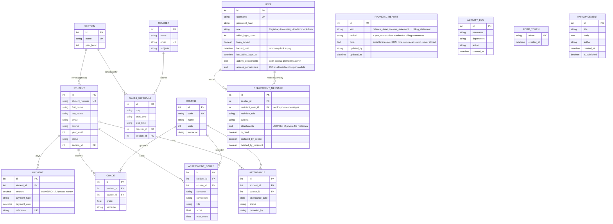

# Database design (ERD)

Generated from the SQLAlchemy models in `app.py`. The diagram renders automatically on GitHub.

`ACTIVITY_LOG`, `FORM_TOKEN` and `ANNOUNCEMENT` have no foreign keys on purpose (the announcement author is stored as text). The log stores the username as text so audit history survives if an account is removed; the token table exists only so the database can reject a second submission of the same form.

## Integrity rules that matter for concurrency

| Table | Rule | Why it matters |
|---|---|---|
| `student` | `student_number` unique | Two registrars cannot end up with the same number; the loser retries with a fresh one |
| `payment` | `reference` unique | Payment references are never duplicated |
| `financial_report` | unique (`kind`, `period`) | One saved copy of each report per year (or per student for billing statements); saves compare `updated_at` so a stale edit is refused instead of overwriting |
| `grade` | unique (`student_id`, `course_id`, `semester`) | Only one grade per student, course and semester, even if two users submit at the same instant |
| `attendance` | unique (`student_id`, `course_id`, `attendance_date`) | One attendance record per student, course and day |
| `form_token` | `token` is the primary key | A form can be accepted only once (double-click protection) |
| `schedule_lock` | one row, locked by every timetable save | Timetable saves run one at a time, so the clash check and the insert cannot interleave (overlapping times cannot be a plain UNIQUE constraint) |
| `class_schedule` | `ON DELETE RESTRICT` to teacher and section | A teacher or section with scheduled classes cannot be deleted by accident |
| `attendance`, `department_message` | `ON DELETE CASCADE` | Dependent rows are removed with their parent. SQLite does not enforce this by default, so deleting a staff account also removes its messages and attachment files in code |
| `student` | ORM cascade `delete-orphan` to payments, grades, scores, attendance | Deleting a student removes their records in one transaction |

## Indexes

Besides primary and unique keys, startup creates indexes on `payment(student_id)`, `payment(payment_date)`, `grade(student_id)`, `grade(course_id)`, `attendance(attendance_date)`, `activity_log(created_at)` and `student(section_id)`. `department_message` and `activity_log.department` are indexed by the models.

## Data types

- Money is `NUMERIC(12,2)` and handled as Python `Decimal`, never floating point. Older databases are converted automatically at startup (PostgreSQL: `ALTER COLUMN ... TYPE NUMERIC(12,2)`; SQLite: values are rounded to two places).
- Grades and assessment scores are floats because they are percentages and scores, not currency.
- Timestamps are stored in UTC and shown in `APP_TIMEZONE` (default `Asia/Manila`).
